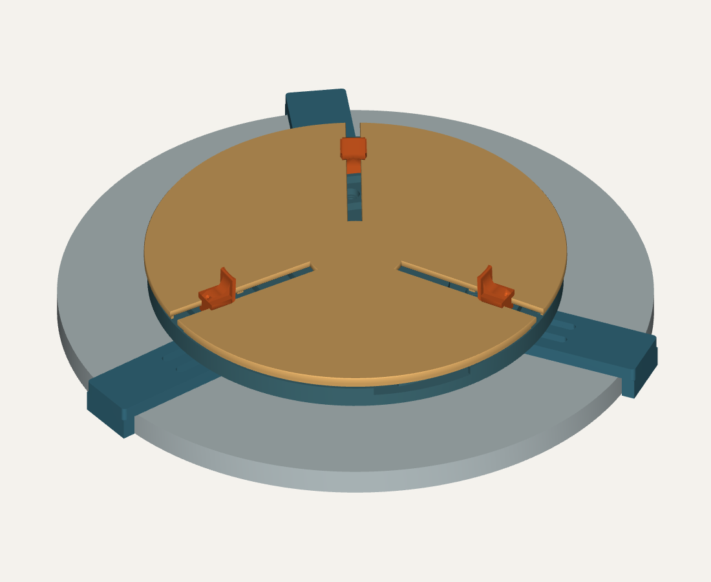

# Giffin Grip Clone for the Prusa CORE One

A three-jaw pottery trimming grip with **one-piece plates** that fit a CORE One. Turning the cover moves all three jaws together. This fork adapts [Giffin Grip Clone by vpxr on Printables](https://www.printables.com/model/624664-giffin-grip-clone) for a smaller print bed and small pots.

The configuration below is for a **275 mm wheelhead rotating counter-clockwise (CCW), viewed from above**. The spiral base is 191.75 mm across and the cover is 195 mm. Measure the **metal wheelhead** across its center; the wheel's advertised size was not a reliable guide to arm length in this build.

## Print the 275 mm CCW version

Open each linked 3MF **as a project** in PrusaSlicer. Print one copy of each of the four plates at **100% scale**. On GitHub, use **Download raw file** to save an individual project, or [download the entire repository as a ZIP](https://github.com/aizerin/griffin_clone_fork/archive/refs/heads/main.zip).

| Plate | What you get |
|---|---|
| [1 · CCW spiral base](models/grip-ccw/3MF/01_Base_CCW.3mf) | One base, printed in one piece |
| [2 · Cover and axle](models/grip-cw/3MF/02_Cover.3mf) | One cover with the axle built in |
| [3 · Short arms, jaws and washer](print/03_Hardware_275mm.3mf) | All three 93.3 mm mounting arms, three low sliders and the axle washer |
| [4 · Wheel spacer](models/grip-cw/3MF/04_Spacer.3mf) | One support ring under the base |

The cover, sliders and spacer above come from the CW set **on purpose**. The mixed assembly was checked with the CCW base; the **spiral base is the only part that needs changing to reverse direction**. For a clockwise wheel, use the [CW base](models/grip-cw/3MF/01_Base.3mf) for plate 1 and keep plates 2–4.

**Try the fit first:** [print one short arm](models/arms-275/3MF/01_One_arm_275mm_v2.3mf) (about 28 min, 14.6 g PETG). Use the **middle and outer pairs of holes** in the base and a 2 mm silicone pad at the rim. The test arm is a real part: keep it if it fits and print one fewer arm on plate 3. The [centering reticle](models/centering-reticle/3MF/01_Centering_reticle.3mf) is optional and comes out before use.

## Assembly and materials

See the [illustrated assembly guide](docs/assembly.md) for fastener positions, jaw orientation, centering and the axle cross-section. In addition to the prints, you need:

- **12 × M4 × 8 mm** low button-head screws (head no larger than 8 mm diameter × 3 mm high) and **12 standard M4 hex nuts** (7 mm across flats × 3.2 mm high).
- **One 13 × 2 mm O-ring** (inside diameter × cross-section) for the groove in the **modified** axle. From below: printed washer first, O-ring second.
- **2 mm adhesive silicone sheet** for the three arm tips and the jaw faces. The arms grip the side of the wheelhead by friction; there is no under-rim latch.

The projects include the **Prusa CORE One INDX 8T HF 0.4 mm / Prusament PETG** profile: 0.20 mm layers, four perimeters and 40% rectilinear infill. The two large plates fit the profile's 248 × 205 mm bed with a 4 mm brim. Organic supports are enabled for the sliders. If you have a standard CORE One, select your own printer/nozzle preset and check the preview before exporting. No machine-ready G-code is distributed.

## Other sizes, parts and source

| If you need… | Use… |
|---|---|
| A **355.6 mm (14 in)** wheelhead | [Long arms and sliders plate](models/grip-cw/3MF/03_Arms_sliders_shim.3mf) instead of plate 3. These arms are 143.3 mm long and use the **inner and outer** hole pairs. |
| Just the replacement arms for **275 mm** | [Three short arms](models/arms-275/3MF/02_Three_arms_275mm_v2.3mf), [STL](models/arms-275/STL/06_adjustable_arm_275mm_v2.stl) or [STEP](models/arms-275/STEP/06_adjustable_arm_275mm_v2.step) |
| A sight for centering the bare base on the wheel | [Reticle instructions, STL and STEP](docs/reticle.md) |
| The original fit coupons, both spiral directions or editable parts | [File map and CAD instructions](docs/files-and-checks.md) |
| How the mechanical fit was checked | [Verification notes](docs/files-and-checks.md#verification) |

**Prototype status:** the files were checked in CAD and sliced. The checks cover selected assembly positions, not a complete physical travel or load test. Holding force, printed tolerances and reticle accuracy still need confirmation on the actual wheel.

## Credit and license

Original design: **[vpxr](https://www.printables.com/@vpxr_793878)**, [Giffin Grip Clone on Printables](https://www.printables.com/model/624664-giffin-grip-clone). This is an independent remix. Changes include smaller plates with full-size M4 seats, a revised axle and washer, a reversed spiral, slider clearance, two arm lengths, a spacer, fit coupons and a removable centering sight. The [upstream source files](upstream/) are kept separately from the modified parts.

The project is distributed under [Creative Commons Attribution–NonCommercial 4.0 International](https://creativecommons.org/licenses/by-nc/4.0/). Credit the original author, identify changes and retain the noncommercial terms when sharing. See [LICENSE.txt](LICENSE.txt).
