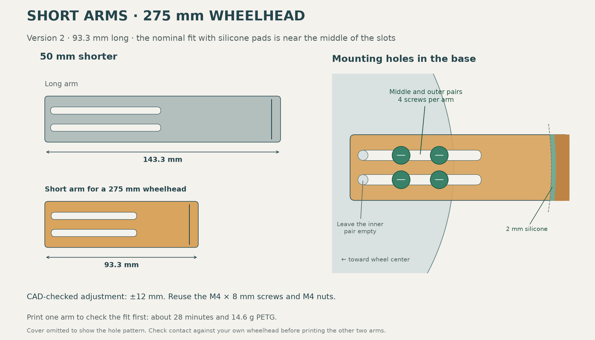
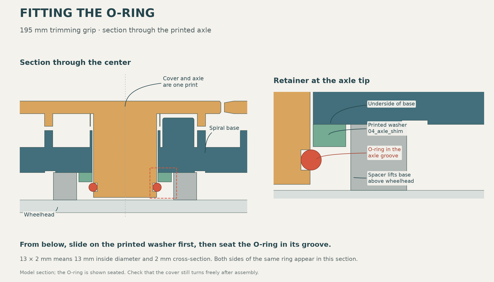
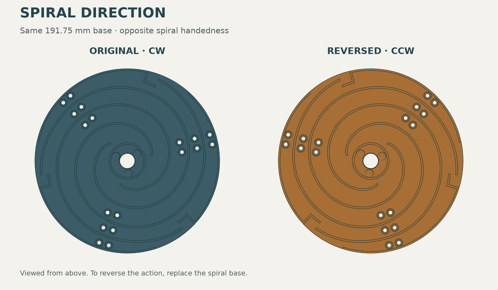

# Assembly

These instructions apply to the modified 195 mm cover, printed axle and low sliders in this repository. The two plates are printed whole. The alignment pegs and gluing instructions in the upstream description were for segmented plates.

## 1. Choose the mounting holes

Look at one group of six screw holes on the base. Starting at the center and moving toward the rim, there is an **inner pair**, a **middle pair** and an **outer pair**. Use four screws per arm, following the row for the arm you actually printed:

| Arm | Nominal wheelhead with 2 mm pads | Use these pairs | Leave empty |
|---|---|---|---|
| Short, 93.3 mm (v2) | 275 mm | Middle + outer | Inner |
| Long, 143.3 mm (v1) | 355.6 mm / 14 in | Inner + outer | Middle |

## 2. Center the base and set the arms

1. Remove brims and slider supports. Clear the tracks, shaft, bore and screw recesses. Check that both plates lie flat.
2. Put the three mounting arms **under** the base with the bent ends pointing down around the wheelhead. Put two M4 nuts in each of the two channels on the underside of each arm. Insert M4 × 8 mm screws **from the spiral side of the base**, with the heads in the recesses. Leave them loose enough for the arms to slide.
3. Put a 2 mm silicone strip (about 28 × 10 mm) on the **inward-facing vertical surface** of each bent end. Place the spacer under the base with the three cutouts around the arms. The arms and spacer support the base 6.5 mm above the wheelhead.
4. Place the base on the stationary wheelhead. If using the [centering reticle](reticle.md), insert it in the **bare central bore** now and align it with the wheel's center mark. Adjust all three arms to contact the rim evenly. Snug the screws, recheck the center and lift out the reticle. The arm tips bear against the side; they do not clip under the wheel.
5. Lift the base off without disturbing the arm settings. Screw heads must sit in their recesses and the tips must clear the wheelhead. M4 × 8 mm leaves about 1 mm of tip clearance in the model; do not assume longer screws will clear.

## 3. Engage the jaws and retain the cover

1. Add silicone to the jaw faces that touch the pot. Insert one low slider from the outer end of each radial cover slot: the jaw faces inward, the follower feet sit below the cover.
2. Set all three sliders the same distance from the center. With the **base spiral facing up**, lower the cover axle into the central bore and ease the follower feet into corresponding channels between the spiral ribs. Turn the cover slightly by hand to find engagement. The plates should seat without forcing them.
3. Hold the plates together and turn them over, keeping the weight off the jaws. From below, slip the **small printed washer** (`04_axle_shim`) over the axle against the underside of the base. Then stretch the **13 × 2 mm O-ring** over the axle tip and seat it all the way around the groove **below** the washer. The large wheel spacer is a different part.
4. Check that the cover still rotates freely and that the O-ring stays seated. Put the spacer back under the base, aligned with the arms. If necessary, tack the spacer to the fixed base only, clear of the moving parts. Do not glue the two plates together.

The axle is 15 mm in diameter with a 13.2 mm groove root. The washer is 22 mm OD × 15.6 mm ID × 2.2 mm. The model leaves about 0.3 mm axial clearance between the washer and seated O-ring. **13 × 2 mm is for this fork**; the original author mentions O-ring shims but does not specify this ring size.

## 4. Check the motion

On the stationary wheel, move the cover by hand. All three jaws should move in or out together. If one lags, lift the cover and reseat all three followers at equal radii. If the plates bind, check for debris, warped plates, a proud screw head or a twisted O-ring. Do not push the jaws past the ends of the spiral. Check that the grip stays centered and clears the splash pan before a slow trial with a small piece.

**Changing rotation later?** Replace only the spiral base. Reuse the cover, three sliders, spacer, washer and correctly sized arms; repeat the centering and hand checks after reassembly.

