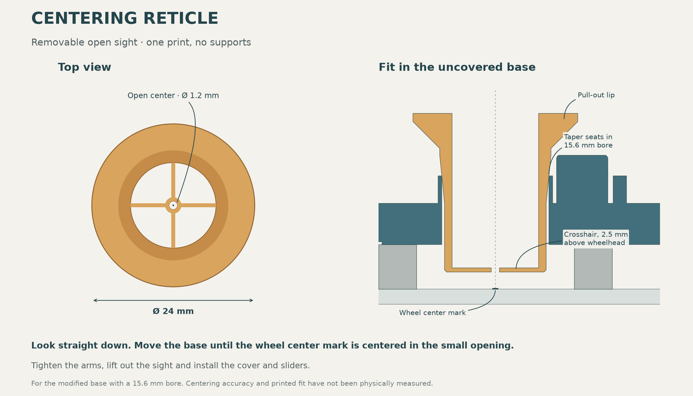

# Centering the bare base

The [centering reticle (3MF)](../models/centering-reticle/3MF/01_Centering_reticle.3mf) is a removable open sight for the **15.6 mm center bore**, compatible with both spiral directions. You can also download the [STL](../models/centering-reticle/STL/01_centering_reticle.stl) or [STEP](../models/centering-reticle/STEP/01_centering_reticle.step). No clear filament or film is needed.

1. Find or mark the true center of the wheelhead. Place the base, spacer and loosely attached arms on the stationary wheel, **without the cover or axle**.
2. Insert the sight from above, narrow end and crosshair first. Let the taper seat lightly in the bore; the wide lip is the handle. It should sit squarely without force.
3. Look straight down to avoid parallax. Move the base until the wheel's center mark sits in the **1.2 mm opening** at the intersection of the crosshair. Tighten the three arms evenly and recheck alignment.
4. Pull the sight out by its lip before fitting the cover. Keep the arm settings when removing the base to fit the axle washer and O-ring.

**Printing:** use the supplied orientation (crosshair on the bed), 100% scale and no supports. The saved CORE One INDX PETG project estimates 14 minutes and 2.74 g. It uses a 3 mm outer brim, 0.45 mm first-layer extrusion width and no elephant-foot compensation to preserve the 0.6 mm wide crosshair. Handle the print by its wall. With another profile, inspect the first three layers: all four lines should connect and the center should remain open.

The sight is approximately 24 × 23.1 mm, with a 12.6 mm clear aperture. The crosshair sits nominally 2.5 mm above the wheel surface. CAD and extrusion-path checks are included in the [verification folder](../models/centering-reticle/verification/). The sight aligns the bore to **your mark**; printed fit and centering accuracy have not been measured.
